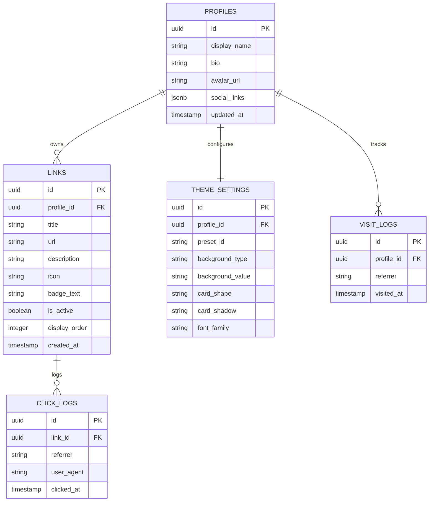

# [PRD] 링크트리 클론 서비스 "마이링크 (My-Link)" 기능 정의서

---

| 항목 | 내용 |
| :--- | :--- |
| **문서 버전** | v1.0.0 |
| **작성일** | 2026-10-11 |
| **상태** | 확정 (Approved) |
| **작성자** | 마이링크 기획/개발팀 |
| **서비스 형태** | 단일 사용자(1인 소유자) 전용 관리자 패널 + 공개 프로필 링크 허브 |
| **기술 스택** | Next.js (App Router), TypeScript, Supabase / Firebase (BaaS) |

---

## 1. 프로젝트 개요 (Project Overview)

### 1.1 프로젝트명
- **서비스명**: 마이링크 (My-Link)
- **영문 표기**: My-Link (Personal Link-in-Bio Platform)

### 1.2 기획 배경 및 목적
- **배경**: 인스타그램, 유튜브, 깃허브, 블로그 등 크리에이터 및 개발자의 디지털 활동 영역이 다변화되면서 이를 하나의 허브로 집약해 노출할 필요성이 커짐. 기존 글로벌 링크트리(Linktree) 서비스는 유료 플랜 제약, 무거운 번들, 커스터마이징의 한계가 존재함.
- **목적**:
  1. 단 하나의 고유 URL을 통해 개인의 모든 소셜 미디어, 프로젝트, 포트폴리오를 가장 직관적이고 감각적으로 전달.
  2. 1인 소유자 전용의 심플하고 직관적인 관리자 패널을 제공하여 링크 수정, 순서 변경, 실시간 모바일 프리뷰 지원.
  3. 링크별 클릭 수 및 일자별 방문자 통계를 수집하여 유입 성과를 시각적으로 분석.
  4. 가볍고 빠른 성능(Next.js App Router)과 감각적인 테마 커스터마이징 기능 제공.

### 1.3 대상 사용자 (Target Audience)
- **주요 타겟 (Owner/관리자)**:
  - 개인 브랜딩이 필요한 1인 크리에이터, 1인 개발자, 프리랜서, 디자이너.
  - 본인의 SNS 프로필(인스타그램, X/트위터 등) 소개란에 단 하나의 링크를 게재하고자 하는 사용자.
- **방문자 (Visitors/End-User)**:
  - 인스타그램, 블로그, 포트폴리오 링크를 클릭하여 소유자의 콘텐츠 및 프로젝트로 유입되는 일반 대중 및 협업 제안자.

---

## 2. 핵심 기능 목록 (Feature Matrix)

기능의 중요도와 개발 단계에 따라 **필수 기능(Must-Have / MVP)**과 **선택·고도화 기능(Nice-to-Have / Phase 2)**으로 구분합니다.

| 구분 | 기능 ID | 기능명 | 중요도 | 세부 설명 |
| :--- | :--- | :--- | :---: | :--- |
| **필수 (Must)** | F-PUB-01 | 공개 프로필 페이지 뷰 | P0 | 프로필 사진, 이름, 소개글, 소셜 아이콘, 링크 카드 렌더링 |
| **필수 (Must)** | F-PUB-02 | 링크 카드 클릭 및 이동 | P0 | 링크 클릭 시 새 탭으로 대상 URL 이동 및 클릭 이벤트 로깅 |
| **필수 (Must)** | F-PUB-03 | 모바일 퍼스트 반응형 레이아웃 | P0 | 모바일 최적화 뷰포트 기반 설계 (데스크톱에서는 카드형 센터 정렬) |
| **필수 (Must)** | F-ADM-01 | 1인 관리자 인증 (로그인/로그아웃) | P0 | 소유자 전용 패스코드/이메일 인증 기반 관리자 페이지 보호 |
| **필수 (Must)** | F-ADM-02 | 링크 관리 CRUD | P0 | 링크 생성(추가), 조회, 수정, 삭제, 공개/숨김(활성 토글) |
| **필수 (Must)** | F-ADM-03 | 드래그 앤 드롭(DnD) 순서 재배치 | P0 | 관리자 화면에서 링크 카드 드래그로 손쉬운 노출 순서 변경 |
| **필수 (Must)** | F-ADM-04 | 실시간 모바일 라이브 프리뷰 | P0 | 관리자 화면 옆에 모바일 기기 형태의 실시간 렌더링 뷰 제공 |
| **필수 (Must)** | F-THM-01 | 테마 커스터마이징 | P1 | 프리셋 테마(미니멀, 다크 네온, 브루탈리즘 등) 및 배경/버튼 커스텀 |
| **필수 (Must)** | F-STA-01 | 통계 분석 대시보드 | P1 | 전체 방문자 수(PV), 링크별 클릭 수, 일자별 추이 차트 |
| **선택 (Nice)** | F-OPT-01 | 공유용 QR 코드 생성 및 다운로드 | P2 | 내 링크 허브 주소의 QR 코드 즉시 생성 및 이미지 다운로드 |
| **선택 (Nice)** | F-OPT-02 | 미디어 임베드 위젯 | P2 | 유튜브 영상 플레이어, 음악 플레이어 임베드 블록 지원 |
| **선택 (Nice)** | F-OPT-03 | 일정 예약/만료 링크 설정 | P2 | 특정 날짜/시간에만 노출되거나 자동 종료되는 기간 한정 링크 |

---

## 3. 기능별 상세 명세 (Detailed Functional Requirements)

### 3.1 [공개 페이지] 프로필 및 링크 허브 뷰 (`F-PUB-01` ~ `F-PUB-03`)

#### (1) 프로필 헤더 섹션
- **아바타 이미지**: 원형 또는 라운드 사각형 프로필 이미지 (클라우드 스토리지 연동).
- **이름 / 닉네임**: 강조된 타이포그래피로 표시.
- **한 줄 소개 (Bio)**: 최대 150자 이내의 자기소개 문구.
- **소셜 아이콘 바**: 주요 소셜 링크(GitHub, Instagram, YouTube, X, LinkedIn, Email) 아이콘 버튼 횡스크롤/가로 정렬 배치.

#### (2) 링크 카드 목록 섹션
- **카드 구성 요소**:
  - 대표 아이콘/파비콘/이모지 (선택 입력)
  - 링크 제목 (Title, 필수)
  - 부가 설명 (Description, 선택)
  - 뱃지/강조 표시 (예: "NEW", "HOT", "포트폴리오" 등)
- **인터랙션**:
  - 카드 마우스 호버/터치 시 부드러운 스케일 업 및 그림자 인터랙션.
  - 클릭 시 새 탭(`_blank`, `rel="noopener noreferrer"`)으로 안전하게 이동.
  - 클릭과 동시에 백그라운드로 클릭 수 카운트 API 비동기 호출.

#### (3) 하단 푸터 및 공유
- **공유 버튼**: 페이지 URL 클립보드 원클릭 복사 토스트 팝업 제공.
- **브랜딩 푸터**: `Powered by My-Link` 문구 (은은한 텍스트 처리).

---

### 3.2 [관리자] 인증 및 보안 (`F-ADM-01`)

- **접근 제어**:
  - 관리자 라우트(`/admin`) 접근 시 인증 세션 검증.
  - 미인증 사용자의 경우 로그인 페이지(`/admin/login`)로 리다이렉트.
- **인증 방식**:
  - Supabase/Firebase Auth 기반 1인 관리자 계정 로그인.
  - JWT 토큰 기반 세션 유지 및 자동 만료 처리.

---

### 3.3 [관리자] 링크 관리 시스템 (`F-ADM-02`, `F-ADM-03`)

#### (1) 링크 항목 속성
| 필드명 | 데이터 타입 | 필수 여부 | 설명 |
| :--- | :--- | :---: | :--- |
| `id` | UUID / String | 필수 | 고유 식별자 |
| `title` | String (최대 50자) | 필수 | 링크 제목 |
| `url` | String (URL 포맷) | 필수 | 이동할 타겟 웹 주소 |
| `description` | String (최대 100자)| 선택 | 링크 부가 설명 |
| `icon` | String (Icon/Emoji) | 선택 | 루시드 아이콘 명칭 또는 이모지 문자 |
| `badge_text` | String (최대 10자) | 선택 | 강조 뱃지 문구 (예: "추천", "공구중") |
| `is_active` | Boolean | 필수 | 노출 활성화 여부 (토글 스위치, 기본 true) |
| `display_order`| Number | 필수 | 정렬 순서 인덱스 |

#### (2) 드래그 앤 드롭(Drag & Drop) 순서 재배치
- 마우스 드래그 또는 모바일 롱프레스 터치로 링크 순서 실시간 변경.
- 순서 변경 완료 시 `display_order` 값이 자동 재계산되어 DB에 일괄 동기화.

---

### 3.4 [관리자] 실시간 모바일 라이브 프리뷰 (`F-ADM-04`)

- **화면 분할 구조 (Split View)**:
  - **좌측 (Editor Pane)**: 링크 추가/수정 폼, 프로필 수정, 테마 설정 탭.
  - **우측 (Device Preview Pane)**: 스마트폰 외형(iPhone Mockup 스타일)의 실시간 뷰어 고정.
- **실시간 반응성**:
  - 좌측에서 링크 텍스트나 테마를 변경하는 즉시 우측 프리뷰에 상태(State)가 무지연 반영.
  - 관리자가 실제 배포된 공개 페이지와 100% 동일한 비주얼을 확인하면서 작업 가능.

---

### 3.5 [테마] 커스터마이징 시스템 (`F-THM-01`)

#### (1) 테마 프리셋 제공
1. **Clean Minimal**: 순백색 배경, 깔끔한 보더라인, 차분한 모노톤 버튼.
2. **Neo-Brutalism**: 고대비 볼드 보더(2px black), 강렬한 원색 컬러, 하드 드롭 섀도우.
3. **Dark Neon**: 딥 다크 배경(#0f172a), 네온 사이언/퍼플 포인트 글로우 효과.
4. **Soft Pastel / Glassmorphism**: 은은한 그라데이션 및 블러 처리된 반투명 카드.

#### (2) 커스텀 세부 설정
- 배경 스타일: 단색(Solid Color) / 선형 그라디언트(Linear Gradient).
- 카드 스타일: 각진 모서리(Square) / 둥근 모서리(Rounded) / 완전 둥근 필(Pill).
- 그림자 효과: 없음 / 부드러운 소프트 섀도우 / 레트로 하드 섀도우.
- 서체(Font): Pretendard, Inter, Montserrat 등 폰트 패밀리 선택.

---

### 3.6 [통계] 애널리틱스 대시보드 (`F-STA-01`)

- **핵심 지표 카드**:
  - 총 방문 수(Total Page Views)
  - 총 링크 클릭 수(Total Link Clicks)
  - 평균 클릭률(Average CTR = 클릭 수 / 방문 수 * 100)
- **링크별 클릭 랭킹**:
  - 어떤 링크가 가장 인기가 많은지 순위별 차트/바 그래프 표시.
- **일자별 추이 차트**:
  - 최근 7일 / 30일 기준 일별 방문자 및 클릭 수 꺾은선/막대 그래프.

---

## 4. 데이터 모델 설계 (Data Model Overview)

---

## 5. 비기능 요구사항 (Non-Functional Requirements)

### 5.1 성능 및 최적화
- **로딩 속도**: 공개 프로필 페이지의 Lighthouse Performance 점수 90점 이상 목표.
- **이미지 최적화**: Next.js `<Image />` 컴포넌트 및 WebP/AVIF 포맷 자동 변환을 통해 첫 화면 페이로드를 500KB 이내로 제한.
- **캐싱 전략**: 공개 프로필 페이지는 ISR(Incremental Static Regeneration) 또는 온디맨드 재검증(On-Demand Revalidation)을 적용하여 고속 응답 보장.

### 5.2 반응형 및 모바일 최적화
- 모바일(320px~480px), 태블릿(768px), 데스크톱(1024px 이상) 전 해상도 대응.
- 모바일 환경에서 터치 타겟 영역 최소 44x44px 이상 확보.

### 5.3 SEO 및 소셜 공유 최적화
- 동적 Open Graph(OG) 메타 태그 생성 (카카오톡, 슬랙, 트위터 공유 시 미리보기 이미지/타이틀 지원).
- Semantic HTML5 마크업 구조(`main`, `header`, `section`, `nav`).

### 5.4 보안
- 관리자 API 엔드포인트의 JWT 유효성 철저 검증.
- 외부 URL 링크 입력 시 `javascript:` 등 악성 스크립트 실행 방지를 위한 URL 스키마 검증(XSS 방지).

---

## 6. 향후 산출물 및 연계 계획 (Next Steps)

본 PRD는 후속 문서 작성을 위한 기준서로 활용됩니다.

1. **사용자 시나리오 정의서 (`docs/user-scenarios.md`)**
   - [시나리오 1] 일반 방문자의 프로필 링크 열람 및 특정 링크 클릭 여정.
   - [시나리오 2] 소유자의 관리자 로그인, 링크 추가 및 드래그 앤 드롭 순서 변경 여정.
   - [시나리오 3] 실시간 모바일 프리뷰를 보며 테마를 변경하고 즉시 반영하는 여정.
   - [시나리오 4] 대시보드에서 링크 클릭 통계를 확인하고 링크를 관리하는 여정.
2. **와이어프레임 설계서 (`docs/wireframes.md`)**
   - 공개 프로필 페이지 와이어프레임 (모바일 뷰 & 데스크톱 뷰).
   - 관리자 대시보드 와이어프레임 (스플릿 뷰: 좌측 설정창 + 우측 모바일 라이브 뷰어).
   - 통계 분석 화면 와이어프레임.
