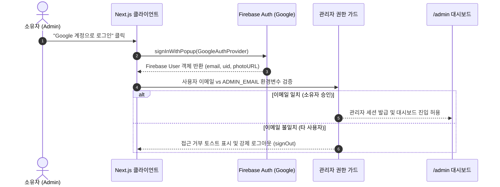

# [PRD] 개발자·크리에이터를 위한 마이링크 (My-Link) 기능 정의서

---

| 항목 | 내용 |
| :--- | :--- |
| **문서 버전** | v1.1.0 |
| **최종 수정일** | 2026-10-11 |
| **상태** | 확정 (Approved) |
| **작성자** | 마이링크 기획/개발팀 |
| **서비스 형태** | 1인 소유자(Owner) 전용 관리자 패널 + 공개 프로필 링크 허브 |
| **핵심 타겟** | 소프트웨어 엔지니어, 1인 개발자, 테크 크리에이터 |
| **기술 스택** | Next.js (App Router), TypeScript, Tailwind CSS, shadcn/ui |
| **BaaS / 인프라** | Firebase (Auth - Google OAuth, Cloud Firestore, Cloud Storage) |

---

## 1. 프로젝트 개요 (Project Overview)

### 1.1 프로젝트명
- **서비스명**: 마이링크 (My-Link)
- **영문 표기**: My-Link (Developer & Creator Link-in-Bio Hub)

### 1.2 기획 배경 및 목적
- **배경**: 개발자와 테크 크리에이터는 GitHub, 기술 블로그(Velog, Tistory, Medium), SNS(X/Twitter, LinkedIn, YouTube), 출시한 사이드 프로젝트 등 다양한 디지털 결과물을 보유하고 있으나, 기존 링크트리는 단순 텍스트 링크 위주라 기술 스택이나 프로젝트 쇼케이스를 표현하기에 한계가 있음.
- **목적**:
  1. **개발자/크리에이터 아이덴티티 특화**: 단순 링크 모음을 넘어 기술 스택 뱃지, 대표 프로젝트(GitHub 소스 / 라이브 데모) 카드를 통합 제공하여 강력한 개인 브랜딩 허브 구축.
  2. **1인 소유자 중심의 직관적 관리**: Firebase Google 소셜 로그인을 통한 간편 인증과 관리자 이메일 화이트리스트 기반의 안전한 접근 제어.
  3. **실시간 모바일 라이브 프리뷰**: 관리자 패널에서 콘텐츠를 수정하면 우측 스마트폰 프리뷰에 즉시 반영되는 반응형 편집 경험 제공.
  4. **shadcn/ui 기반의 모던 디자인 시스템**: 일관성 있고 세련된 UI/UX 및 유연한 테마 커스터마이징 지원.

### 1.3 대상 사용자 (Target Audience)
- **주요 타겟 (소유자 / 관리자)**:
  - 포트폴리오 및 SNS 링크를 단일 허브로 깔끔하게 정리하고 싶은 개발자 및 테크 크리에이터.
  - 별도의 복잡한 백엔드 서버 구축 없이 Firebase로 간편하게 자신의 링크 허브를 유지보수하고 싶은 1인 운영자.
- **방문자 (Visitors / End-User)**:
  - SNS(X, 인스타그램, 링크드인), 이력서, 이메일 서명 등을 통해 유입되어 소유자의 프로젝트와 활동 내역을 확인하는 리크루터, 협업 제안자, 동료 개발자, 팔로워.

---

## 2. 핵심 기능 목록 (Feature Matrix)

요구사항에 따라 핵심 기능은 **MVP (Phase 1: 현재 필수 구현)**과 **Phase 2 (추후 고도화 / 선택 구현)**로 명확히 분리합니다.

| 구분 | 기능 ID | 기능명 | 중요도 | 세부 설명 |
| :--- | :--- | :--- | :---: | :--- |
| **MVP (필수)** | F-PUB-01 | 공개 프로필 헤더 | P0 | 프로필 아바타, 이름, 직무/타이틀, 한 줄 Bio, 소셜 아이콘 바 |
| **MVP (필수)** | F-PUB-02 | 기술 스택(Tech Stack) 뱃지 블록 | P0 | 프론트/백엔드/도구 등 사용 기술 뱃지 목록 렌더링 |
| **MVP (필수)** | F-PUB-03 | 대표 프로젝트 쇼케이스 카드 | P0 | 프로젝트 썸네일, 설명, GitHub 링크, Live Demo 버튼 제공 |
| **MVP (필수)** | F-PUB-04 | 커스텀 링크 카드 목록 | P0 | 블로그, SNS, 아티클 등 주요 링크 목록 및 새 탭 이동 |
| **MVP (필수)** | F-PUB-05 | 모바일 퍼스트 반응형 뷰 | P0 | 모바일 최적화 레이아웃 및 데스크톱 센터 정렬 뷰포트 |
| **MVP (필수)** | F-AUTH-01 | Firebase Google 소셜 로그인 | P0 | Google OAuth 전용 원클릭 로그인 |
| **MVP (필수)** | F-AUTH-02 | 관리자 화이트리스트 접근 제어 | P0 | 환경변수(`ADMIN_EMAIL`)와 일치하는 소유자만 `/admin` 접근 허용 |
| **MVP (필수)** | F-ADM-01 | 통합 콘텐츠 CRUD 관리 | P0 | 링크, 프로젝트, 기술 스택 항목의 추가·수정·삭제·공개 토글 |
| **MVP (필수)** | F-ADM-02 | 드래그 앤 드롭(DnD) 순서 재배치 | P0 | 링크 및 프로젝트 카드의 손쉬운 노출 순서 변경 |
| **MVP (필수)** | F-ADM-03 | 실시간 모바일 라이브 프리뷰 | P0 | 관리자 화면 내 모바일 기기 목업 실시간 렌더링 |
| **MVP (필수)** | F-THM-01 | shadcn/ui 기반 테마 커스텀 | P1 | 다크/라이트 모드 토글, 테마 프리셋 및 스타일 커스터마이징 |
| **Phase 2 (선택)** | F-STA-01 | 방문자 및 링크 클릭 통계 (Analytics) | P2 | 일자별 방문자 수(PV), 링크/프로젝트별 클릭 수 대시보드 |
| **Phase 2 (선택)** | F-OPT-01 | 공유용 QR 코드 생성 및 다운로드 | P2 | 내 링크 허브 주소의 QR 코드 즉시 생성 및 이미지 다운로드 |
| **Phase 2 (선택)** | F-OPT-02 | 미디어 임베드 위젯 | P2 | 유튜브 영상 플레이어, 음악 플레이어 임베드 블록 |
| **Phase 2 (선택)** | F-OPT-03 | 일정 예약/만료 링크 설정 | P2 | 특정 날짜/시간에만 노출되거나 자동 종료되는 기간 한정 링크 |

---

## 3. 기능별 상세 명세 (Detailed Functional Requirements)

### 3.1 [공개 페이지] 개발자·크리에이터 특화 허브 (`F-PUB-01` ~ `F-PUB-05`)

#### (1) 프로필 헤더 (`F-PUB-01`)
- **컴포넌트 (shadcn/ui)**: `Avatar`, `Badge`
- **표시 정보**:
  - 원형 아바타 (Firebase Storage 호스팅 이미지)
  - 이름 및 전문 직무 타이틀 (예: *“홍길동 | Full-Stack Engineer & Tech Writer”*)
  - 한 줄 소개 (Bio, 마크다운/이모지 지원)
  - 소셜 아이콘 바 (GitHub, X/Twitter, LinkedIn, YouTube, 이메일 등 Lucide React 아이콘)

#### (2) 기술 스택 뱃지 블록 (`F-PUB-02`)
- **컴포넌트 (shadcn/ui)**: `Badge`
- **표시 방식**:
  - 카테고리별(예: Frontend, Backend, DevOps/Tools) 또는 단일 리스트 형태.
  - 마우스 호버 시 인터랙티브 하이라이트 애니메이션.

#### (3) 대표 프로젝트 쇼케이스 (`F-PUB-03`)
- **컴포넌트 (shadcn/ui)**: `Card`, `Button`, `Badge`
- **카드 구성**:
  - 프로젝트 썸네일 이미지
  - 프로젝트명 및 한 줄 핵심 설명
  - 사용 기술 태그 뱃지
  - 액션 버튼 2종:
    - `GitHub` (소스 코드 레포지토리 이동)
    - `Demo / Web` (실제 배포 서비스 이동)

#### (4) 커스텀 링크 카드 (`F-PUB-04`)
- **컴포넌트 (shadcn/ui)**: `Button`, `Card`
- **구성 요소**: 대표 아이콘/파비콘 + 링크 타이틀 + 서브텍스트 + 뱃지(예: `NEW`, `HOT`, `BLOG`)
- **인터랙션**: 호버 시 부드러운 엘리베이션 상승 효과, 클릭 시 새 탭 안전 이동(`noopener noreferrer`).

---

### 3.2 [인증 & 보안] Firebase Google 소셜 로그인 (`F-AUTH-01`, `F-AUTH-02`)



- **인증 방식**:
  - Firebase SDK의 `GoogleAuthProvider`를 사용한 팝업/리다이렉트 로그인.
- **접근 통제 (White-list)**:
  - 서버 및 클라이언트 환경변수(`NEXT_PUBLIC_ADMIN_EMAIL`)에 지정된 1개의 이메일 주소만 관리자 권한을 획득.
  - 인가되지 않은 구글 계정으로 로그인 시 즉시 `signOut` 처리 및 “관리자 권한이 없는 계정입니다” 알림 표시.
- **라우트 보호**:
  - Next.js 미들웨어 및 클라이언트 Auth Wrapper를 통해 `/admin` 하위 페이지 미인증 접근 차단.

---

### 3.3 [관리자 패널] 콘텐츠 관리 & 순서 재배치 (`F-ADM-01`, `F-ADM-02`)

- **관리 탭 구조 (shadcn/ui `Tabs`)**:
  1. **프로필 설정**: 이름, 직무, Bio, 소셜 링크, 아바타 이미지 업로드(Firebase Storage).
  2. **링크 관리**: 일반 링크 카드 CRUD.
  3. **프로젝트 관리**: 대표 프로젝트 쇼케이스 카드 CRUD (이미지 업로드, GitHub/Demo URL 설정).
  4. **기술 스택 관리**: 기술 뱃지 추가 및 카테고리 설정.
- **드래그 앤 드롭 (DnD) 순서 변경**:
  - `@dnd-kit` 라이브러리를 활용하여 링크 및 프로젝트 카드의 상하 순서를 직관적으로 드래그하여 재배치.
  - 드래그 완료 시 `order` 인덱스가 Firestore에 즉시 일괄 갱신.
- **공개/비공개 토글 (shadcn/ui `Switch`)**:
  - 작업 중이거나 숨기고 싶은 항목은 원클릭 토글로 공개 페이지에서 즉시 비활성화.

---

### 3.4 [관리자 패널] 실시간 모바일 라이브 프리뷰 (`F-ADM-03`)

- **스플릿 레이아웃 (Split View)**:
  - **좌측 (Editor Area, 약 60%)**: 폼 입력, 스위치, 드래그 핸들, 액션 버튼 등.
  - **우측 (Preview Area, 약 40%)**: 모바일 스마트폰 목업 프레임 내에 공개 페이지 실시간 렌더링.
- **실시간 반응형 동기화**:
  - React State 기반으로 폼 입력 즉시 프리뷰 목업 화면이 리렌더링되어 결과물을 직관적으로 확인.

---

### 3.5 [디자인 시스템] shadcn/ui 기반 테마 커스텀 (`F-THM-01`)

- **shadcn/ui 컴포넌트 세트 도입**:
  - `Button`, `Card`, `Badge`, `Avatar`, `Input`, `Textarea`, `Switch`, `Tabs`, `Dialog`, `DropdownMenu`, `Separator`, `Toast (Sonner)`
- **테마 시스템**:
  - `next-themes` 기반 라이트 모드 / 다크 모드 지원.
  - **프리셋 스타일**:
    - **Modern Minimal (기본)**: 절제된 모노톤, 섬세한 보더, 심플한 뱃지.
    - **Developer Dark**: 다크 슬레이트 배경, 코드 블록 감성의 폰트 및 액센트 컬러.
    - **Vibrant Accent**: 선명한 포인트 컬러(인디고/바이올렛)를 적용한 크리에이터 스타일.

---

### 3.6 [Phase 2] 추후 고도화 기능 명세 (`F-STA-01` 외)

- **방문자 및 클릭 통계 (`F-STA-01`)**:
  - 공개 페이지 조회 시 일별 PV 누적.
  - 링크 카드 및 프로젝트 GitHub/Demo 버튼 클릭 시 이벤트 카운팅.
  - 관리자 대시보드 내 간단한 차트(Recharts) 형태로 노출.
- **QR 코드 다운로드 (`F-OPT-01`)**:
  - `qrcode.react` 라이브러리를 사용하여 공개 프로필 URL에 대한 고해상도 PNG 다운로드 지원.

---

## 4. 데이터 아키텍처 및 Firestore 컬렉션 설계

Firebase Firestore NoSQL 데이터베이스 구조:

```text
/config/profile (Document: 1인 프로필 정보)
  ├── displayName: string
  ├── title: string
  ├── bio: string
  ├── avatarUrl: string
  ├── socialLinks: { github, twitter, linkedin, youtube, email }
  └── theme: { mode, presetId, accentColor }

/techStacks/{techId} (Collection: 기술 스택 뱃지)
  ├── name: string (예: "Next.js", "TypeScript")
  ├── category: string (예: "Frontend", "Backend")
  ├── order: number
  └── isVisible: boolean

/projects/{projectId} (Collection: 대표 프로젝트)
  ├── title: string
  ├── description: string
  ├── thumbnailUrl: string
  ├── githubUrl: string
  ├── demoUrl: string
  ├── tags: string[]
  ├── order: number
  └── isVisible: boolean

/links/{linkId} (Collection: 커스텀 링크)
  ├── title: string
  ├── url: string
  ├── description: string
  ├── icon: string
  ├── badgeText: string
  ├── order: number
  └── isVisible: boolean
```

---

## 5. 비기능 요구사항 (Non-Functional Requirements)

1. **성능 & 로딩 속도**:
   - Next.js 서버 컴포넌트(RSC)를 활용해 공개 프로필 페이지의 초기 HTML을 즉시 전달.
   - Core Web Vitals (LCP < 1.2s, CLS < 0.05) 최적화 달성.
2. **보안 (Security)**:
   - **Firestore 보안 규칙(Security Rules)**:
     - `links`, `projects`, `techStacks`, `profile`에 대한 읽기(`read`)는 모든 사용자(`allow read: if true;`)에게 공개.
     - 쓰기/수정/삭제(`write`)는 오직 인증된 토큰의 이메일이 관리자 화이트리스트 이메일과 일치할 때만 허용(`request.auth.token.email == "owner@gmail.com"`).
3. **접근성 및 디자인 일관성**:
   - `shadcn/ui`의 Radix UI 프리미티브를 준수하여 완벽한 키보드 내비게이션 및 ARIA 지원.
4. **SEO 및 SNS 최적화**:
   - 동적 Open Graph(OG) 태그를 적용하여 카카오톡, 슬랙, X, 링크드인에 URL 공유 시 매력적인 미리보기 카드 렌더링.

---

## 6. 향후 산출물 및 문서 연계 계획

1. **사용자 시나리오 정의서 (`docs/user-scenarios.md`)**
   - [시나리오 1] 일반 방문자의 프로필 조회, 기술 스택 확인 및 프로젝트 Demo/GitHub 클릭 여정.
   - [시나리오 2] 소유자의 Google 원클릭 로그인 및 화이트리스트 인가 여정.
   - [시나리오 3] 실시간 모바일 프리뷰를 보며 새 프로젝트 추가 및 DnD 순서 변경 여정.
2. **와이어프레임 설계서 (`docs/wireframes.md`)**
   - 공개 프로필 페이지 (모바일 뷰 & 데스크톱 뷰, 기술 스택 뱃지 및 프로젝트 쇼케이스 배치).
   - 관리자 대시보드 (스플릿 레이아웃: 좌측 shadcn 탭 폼 + 우측 모바일 라이브 뷰어).
