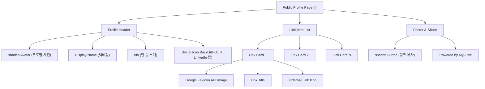
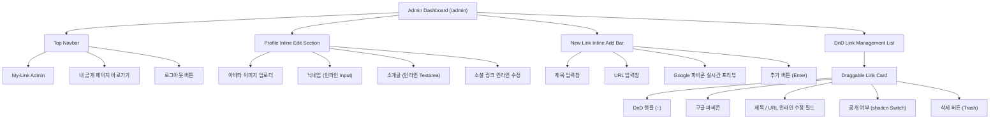

# [와이어프레임] 마이링크 (My-Link) UI/UX 와이어프레임 설계서

---

| 항목 | 내용 |
| :--- | :--- |
| **문서 버전** | v1.0.0 |
| **작성일** | 2026-10-11 |
| **상태** | 확정 (Approved) |
| **연관 문서** | [PRD.md](file:///c:/Users/songshoo/Documents/my-link/docs/PRD.md) v1.3.0, [user-scenarios.md](file:///c:/Users/songshoo/Documents/my-link/docs/user-scenarios.md) v1.0.0 |
| **디자인 시스템** | Tailwind CSS + shadcn/ui (단일 모던 미니멀 스타일) |

---

## 1. 컴포넌트 계층 구조 (Component Hierarchy)

### 1.1 공개 프로필 페이지 컴포넌트 트리


### 1.2 관리자 대시보드 컴포넌트 트리


---

## 2. 화면 1: 공개 프로필 페이지 (Public Profile Page)

### 2.1 모바일 뷰 와이어프레임 (Mobile Viewport: 360px ~ 430px)

```text
+-----------------------------------------------+
|  [ 상태 표시줄: 09:41              5G [||||] ] |
+-----------------------------------------------+
|                                               |
|                    [ (O) ]  <- 원형 아바타     |
|                               (80x80px)       |
|                                               |
|                  송슈 (Song-Wick)              |
|        Full-Stack Engineer & Tech Writer      |
|                                               |
|            "코드로 가치를 만들고 기록합니다."        |
|                                               |
|          [GitHub] [X] [LinkedIn] [Email]      |
|                                               |
|  -------------------------------------------  |
|                                               |
|  +-----------------------------------------+  |
|  | [G]  내 깃허브 저장소             [->]  |  | <- 구글 파비콘
|  +-----------------------------------------+  |    연동 링크 카드
|                                               |    (높이: 54px)
|  +-----------------------------------------+  |
|  | [V]  개발 기술 블로그 (Velog)     [->]  |  |
|  +-----------------------------------------+  |
|                                               |
|  +-----------------------------------------+  |
|  | [N]  사이드 프로젝트 노션 포트폴리오 [->]  |  |
|  +-----------------------------------------+  |
|                                               |
|  +-----------------------------------------+  |
|  | [Y]  유튜브 개발 브이로그 채널    [->]  |  |
|  +-----------------------------------------+  |
|                                               |
|                                               |
|              [  [🔗] 링크 복사  ]              | <- 클립보드 복사
|                                               |
|             Powered by My-Link                |
|                                               |
+-----------------------------------------------+
```

### 2.2 데스크톱 뷰 와이어프레임 (Desktop Viewport: >= 1024px)
- 모바일 퍼스트 레이아웃을 유지하면서 데스크톱 화면 중앙에 폭 520px의 안정적인 카드형 컨테이너로 정렬됩니다.

```text
+---------------------------------------------------------------------------------------+
|                                                                                       |
|                                                                                       |
|                               +-----------------------+                               |
|                               |         (O)           |                               |
|                               |                       |                               |
|                               |    송슈 (Song-Wick)    |                               |
|                               |   Full-Stack Engineer |                               |
|                               |                       |                               |
|                               | [GH] [X] [IN] [MAIL]  |                               |
|                               |                       |                               |
|                               | +-------------------+ |                               |
|                               | | [G] GitHub   [->] | |                               |
|                               | +-------------------+ |                               |
|                               | | [V] TechBlog [->] | |                               |
|                               | +-------------------+ |                               |
|                               | | [N] Notion   [->] | |                               |
|                               | +-------------------+ |                               |
|                               |                       |                               |
|                               |     [ 링크 복사 ]     |                               |
|                               |   Powered by My-Link  |                               |
|                               +-----------------------+                               |
|                                                                                       |
+---------------------------------------------------------------------------------------+
```

---

## 3. 화면 2: 관리자 로그인 페이지 (Admin Login Page, `/admin/login`)

```text
+---------------------------------------------------------------------------------------+
|                                                                                       |
|                            +-------------------------------+                          |
|                            |         MY-LINK ADMIN         |                          |
|                            |  소유자 전용 관리자 로그인     |                          |
|                            +-------------------------------+                          |
|                            |                               |                          |
|                            |  마이링크 페이지를 관리하려면   |                          |
|                            |  소유자 계정으로 로그인하세요.  |                          |
|                            |                               |                          |
|                            | +---------------------------+ |                          |
|                            | | [G] Google 계정으로 로그인 | | <- 원클릭 소셜 로그인
|                            | +---------------------------+ |    (Firebase Auth)
|                            |                               |                          |
|                            | * 승인된 관리자 이메일만     |                          |
|                            |   접근이 허용됩니다.          |                          |
|                            +-------------------------------+                          |
|                                                                                       |
+---------------------------------------------------------------------------------------+
```

---

## 4. 화면 3: 관리자 대시보드 페이지 (Admin Dashboard, `/admin`)

모바일 라이브 프리뷰를 제거하고, 화면 전체 폭을 효율적으로 사용하는 **단일 컬럼 작업 집중형 레이아웃**입니다.

### 4.1 대시보드 전체 레이아웃 (Admin Dashboard Full View)

```text
+---------------------------------------------------------------------------------------+
| [🔗 My-Link Admin]                        [ 내 페이지 열기 ↗ ]  [ 송슈(소유자) | 로그아웃 ] |
+---------------------------------------------------------------------------------------+
|                                                                                       |
|  [ 1. 프로필 관리 (인라인 편집) ]                                                       |
|  +---------------------------------------------------------------------------------+  |
|  |  ( [O] )  닉네임:  [ 송슈 (Song-Wick)               ] (클릭하여 즉시 수정)        |  |
|  |  사진변경  소개글:  [ 코드로 가치를 만들고 기록하는 엔지니어입니다. ]                |  |
|  |                                                                                 |  |
|  |  소셜 링크: [GitHub: github.com/song-wick    ] [X: x.com/song_wick           ]  |  |
|  +---------------------------------------------------------------------------------+  |
|                                                                                       |
|  [ 2. 새 링크 추가 (인라인 바) ]                                                        |
|  +---------------------------------------------------------------------------------+  |
|  | [ 파비콘 ] [ 제목: 포트폴리오 노션      ] [ URL: https://notion.site/... ] [ + 추가 ] |  |
|  |  (실시간)   (최대 50자)                     (입력 시 파비콘 자동 추출)       (Enter) |  |
|  +---------------------------------------------------------------------------------+  |
|                                                                                       |
|  [ 3. 링크 목록 및 순서 관리 (드래그 앤 드롭 & 인라인 수정) ]                           |
|  +---------------------------------------------------------------------------------+  |
|  | [::] [G] 깃허브 메인 저장소       https://github.com/song-wick    [ 공개: [ON] ] [휴지통] |
|  |---------------------------------------------------------------------------------|  |
|  | [::] [V] 벨로그 기술 블로그       https://velog.io/@song-wick     [ 공개: [ON] ] [휴지통] |
|  |---------------------------------------------------------------------------------|  |
|  | [::] [N] 사이드 프로젝트 소개     https://notion.so/my-projects   [ 공개: [ON] ] [휴지통] |
|  |---------------------------------------------------------------------------------|  |
|  | [::] [Y] 개발 유튜브 채널         https://youtube.com/@dev_song   [ 공개: [OFF]] [휴지통] |
|  +---------------------------------------------------------------------------------+  |
|    ^     ^   ^                      ^                                 ^         ^     |
|   드래그 파비콘  제목(인라인 클릭수정)    URL(인라인 클릭수정)            공개토글    삭제   |
|                                                                                       |
+---------------------------------------------------------------------------------------+
```

---

## 5. 인라인 편집(Inline Editing) 인터랙션 비교 목업

별도의 모달(Dialog) 창 없이, 텍스트를 클릭했을 때 그 자리에서 즉시 수정 모드로 전환되는 인터랙션입니다.

### 5.1 링크 아이템: [일반 뷰] vs [인라인 편집 뷰]

#### [상태 A: 일반 뷰 (Normal View)]
```text
+-------------------------------------------------------------------------------------+
| [::]  [G]  깃허브 메인 저장소       https://github.com/song-wick    [ON]   [🗑️]      |
+-------------------------------------------------------------------------------------+
        ^            ^                            ^
   구글 파비콘    (클릭 시 수정 모드)         (클릭 시 수정 모드)
```

#### [상태 B: 인라인 편집 뷰 (Editing State - 클릭 즉시 전환)]
```text
+-------------------------------------------------------------------------------------+
| [::]  [G]  [ 깃허브 메인 저장소_   ] [ https://github.com/song-wick_ ]  [ON]   [🗑️]  |
+-------------------------------------------------------------------------------------+
                   ^                               ^
             shadcn Input 활성화              shadcn Input 활성화
       (엔터 or 포커스아웃 시 즉시 저장)   (URL 변경 시 파비콘 실시간 갱신)
```

---

### 5.2 프로필/닉네임: [일반 뷰] vs [인라인 편집 뷰]

#### [상태 A: 일반 뷰]
```text
송슈 (Song-Wick)  [✏️]
코드로 가치를 만들고 기록하는 엔지니어입니다.
```

#### [상태 B: 닉네임 텍스트 클릭 시]
```text
[ 송슈 (Song-Wick)____________ ]  (Enter 또는 바깥 클릭 시 저장)
코드로 가치를 만들고 기록하는 엔지니어입니다.
```

---

## 6. shadcn/ui 컴포넌트 맵핑 가이드

| UI 영역 | 사용 shadcn/ui 컴포넌트 | 비고 / 세부 스타일 |
| :--- | :--- | :--- |
| **프로필 아바타** | `Avatar`, `AvatarImage`, `AvatarFallback` | 80x80px(모바일) 원형, 테두리 border-border |
| **공개 링크 카드** | `Card` | 높이 54px, hover:scale-[1.01], 부드러운 전환 효과 |
| **파비콘 아이콘** | `` + Google Favicon API | 24x24px, rounded-sm, onError 시 Lucide `Globe` 폴백 |
| **공개/숨김 스위치** | `Switch` | 관리자 화면 링크 노출 제어 (즉시 Firestore boolean 업데이트) |
| **텍스트 입력창** | `Input`, `Textarea` | 인라인 편집 활성화 시 autofocus 처리 |
| **버튼 & 액션** | `Button` | 링크 복사(`variant="outline"`), 링크 추가(`variant="default"`) |
| **알림 메시지** | `Toast (Sonner)` | '복사 완료', '저장 완료', '삭제 완료' 시 하단 알림 토스트 |
| **삭제 확인** | `AlertDialog` | 실수로 삭제하는 것 방지 (확인 팝업) |
